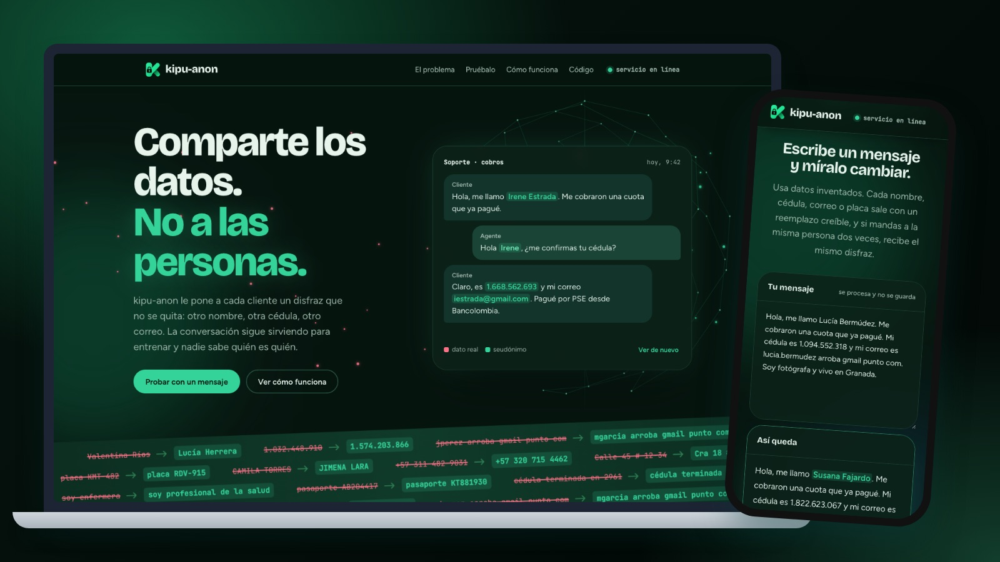
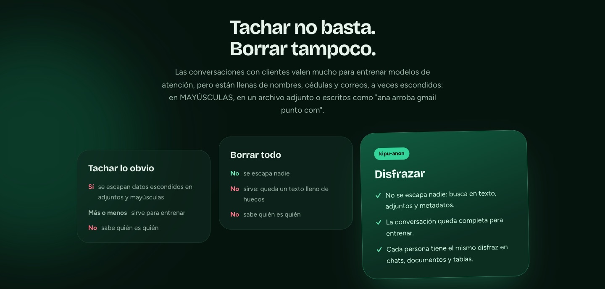
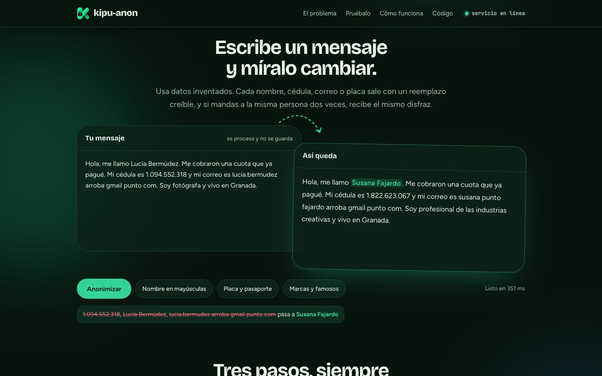
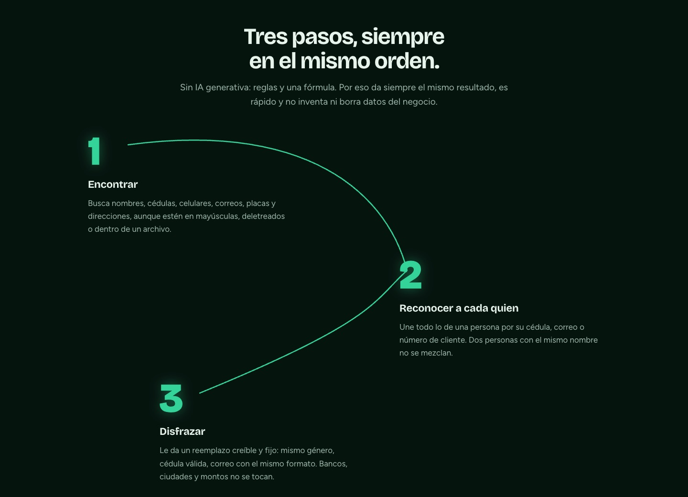
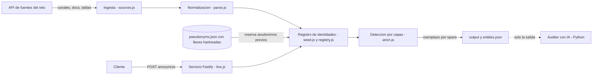

<div align="center">


# kipu-anon

### Comparte los datos, no a las personas: seudonimización determinista para el corpus de soporte de Kipu Pay.

[](https://kipu-anon.vercel.app)
[](https://kipu-anon.vercel.app/v1/health)
[](#-reto-frontier-cdmx26)


<br/>


<br/>



**[▶ Probar con un mensaje](https://kipu-anon.vercel.app/#prueba)** · **[Cómo funciona](#-cómo-funciona)** · **[Decisiones y costo](DECISIONS.md)** · **[Guía del equipo](docs/EQUIPO.md)**

</div>

> [!IMPORTANT]
> Todo lo que se ve en este README y en las capturas son **datos de ejemplo inventados** (los de la carátula y la demo). El corpus del reto nunca se sube al repo: `raw/`, `fuentes/`, `output/` y cualquier `entities.json` con `originals` quedan fuera porque traen datos personales. `data/pseudonyms.json` guarda solo seudónimos con las llaves hasheadas.

---

## 🎯 El problema

Kipu Pay, una fintech colombiana ficticia del reto, quiere **vender sus conversaciones de soporte** para entrenar modelos de atención, **sin vender a la gente**. Esas conversaciones están llenas de nombres, cédulas, celulares y correos, muchas veces escondidos: en MAYÚSCULAS, en un adjunto, en la metadata de un PDF o escritos como "ana arroba gmail punto com".

- **Tachar lo obvio** deja escapar los datos escondidos.
- **Borrar todo** deja un texto lleno de huecos que ya no sirve para entrenar.
- Ninguna de las dos sabe **quién es quién**.

<div align="center">

</div>

## 💡 La solución: un disfraz que no se quita

Cada persona real se reemplaza por un **seudónimo verosímil, único y estable entre corridas** (otro nombre, otra cédula válida, otro correo con el mismo formato); **el resto del texto queda byte a byte**. Bancos, marcas, lugares, figuras públicas, montos e ids de negocio no se tocan.

```
 Entrada:  Hola, me llamo Lucía Bermúdez. Me cobraron una cuota que ya pagué. Mi cédula es 1.094.552.318
           y mi correo es lucia.bermudez arroba gmail punto com. Soy fotógrafa y vivo en Granada.
 Salida:   Hola, me llamo Susana Fajardo. Me cobraron una cuota que ya pagué. Mi cédula es 1.822.623.067
           y mi correo es susana punto fajardo arroba gmail punto com. Soy profesional de las industrias
           creativas y vivo en Granada.
```

<sub>Ejemplo real de la demo en vivo, con el texto de ejemplo inventado que trae la carátula. La ocupación pasa a sector (cuasi-identificador).</sub>

El motor es **por reglas y una fórmula**, sin IA generativa: `ψ(e) = catálogo[HMAC(sal, llave estable)]`. Por eso da siempre el mismo resultado, es rápido y no inventa ni borra datos del negocio. La IA se usa aparte, como **auditor independiente** y como **adversario** que intenta engañarlo (ver [DECISIONS.md](DECISIONS.md)).

## ✨ Funciones principales

<table>
<tr>
<td width="50%"><br/><b>Demo en vivo:</b> escribe un mensaje con datos inventados y míralo cambiar. Llama al endpoint real <code>/v1/anonymize</code>; el mensaje se procesa y no se guarda.</td>
<td width="50%"><br/><b>Tres pasos, siempre en el mismo orden:</b> encontrar, reconocer a cada quien (sin unir nunca solo por nombre) y disfrazar.</td>
</tr>
</table>

- **Detección por capas** sobre texto normalizado como el juez: correos (también "arroba/punto"), menciones `<@U…>`, direcciones, cédulas y celulares (también con separadores raros o en palabras), fechas de nacimiento, placas, pasaportes, nombres en cualquier forma, nombres de pila en contexto, terceros no registrados y cuasi-identificadores.
- **Todos los formatos:** chats por hilo, PDF (texto y metadata `/Info`, sin librerías), HTML a markdown conservando `<meta>` y comentarios, CSV Latin-1 y XML.
- **Homónimos:** un usuario del chat se liga a su fila del maestro comparando toda la evidencia (cédula, correo, celular, id, radicado PQR, montos, barrio).
- **Estable ante el incidente:** cuando las fuentes crecen, el mapa de seudónimos solo crece y las personas de antes conservan su disfraz.
- **Privacidad del propio API:** `/anonymize` solo devuelve los datos originales que venían en lo que se mandó, nunca datos del corpus de otra persona.

## 🧠 Cómo funciona



| Archivo | Qué hace |
|---|---|
| `src/sources.js` | Baja canales, días de chat, documentos, tablas y `record_index`; compara contra la corrida anterior para detectar crecimiento de fuentes. |
| `src/parse.js` | Lleva todo al esquema de salida. PDF (texto y metadata del diccionario `/Info`, sin librerías), HTML a markdown conservando `<meta>` y comentarios, CSV Latin-1, XML. |
| `src/seed.js` | Siembra el registro con clientes, empleados y usuarios de Slack. Liga cada usuario cliente con su fila del maestro por correo, nombre exacto o evidencia en sus hilos. |
| `src/registry.js` | Personas con todas sus llaves y su seudónimo `ψ(e) = catálogo[HMAC(sal, llave estable)]`; valores falsos con formato válido que nunca coinciden con un valor real. |
| `src/anon.js` | Detección por capas sobre texto normalizado como el juez. |
| `src/pipeline.js` | Orquesta chats por hilo, documentos y filas; arma `entities.json` desde el mismo registro que hizo los reemplazos. |
| `src/live.js` | `/anonymize`: mismo registro, autores resueltos por nombre y llaves fuertes; personas nuevas reciben seudónimo nuevo. |
| `src/service.js` | Fastify. Igual en local y en Vercel. |
| `auditor/auditor.py` | **Auditor independiente con IA (Python).** Lee la salida ya anonimizada, pide a un modelo que marque cualquier dato que parezca de una persona real y cruza cada hallazgo contra la entrada para separar fugas reales de seudónimos bien hechos. |
| `auditor/adversario.py` | **Adversario con IA (Python).** Inventa mensajes de soporte diseñados para engañar al anonimizador, cada uno con la lista exacta de datos que deben desaparecer. Los casos son inventados, no traen datos reales. |
| `scripts/check.js` | Gate antes de gastar una corrida: barrido global de fuga con la normalización del juez y tests públicos y de muestra. |

### Contrato del servicio

`/health` · `/run` · `/run/{job_id}` · `/output/{archivo}` · `/anonymize` · `/entities` (base: `https://kipu-anon.vercel.app/v1`). La carátula solo se sirve a navegadores (`Accept: text/html`); el API sigue respondiendo JSON en `/` y `/v1`.

## 📊 Resultados (31-oct, 15:00)

| Revisión | Resultado |
|---|---|
| Corrida oficial 1 (versión anterior del equipo, Render) | 77 / 95 (60 % del set) |
| Corrida oficial 2 (esta versión, Vercel) | 94 / 118 (75 % del set) |
| Validador oficial | OK |
| Juez local (`npm run juez`) | 1.765 / 1.765 |
| Pruebas en vivo de `/anonymize` (`npm run live`) | 39 / 39 |
| Adversario con IA, ronda 1 / ronda 2 | 131 / 150 · 119 / 151 casos limpios (lo demás son marcas equivocadas del modelo: ciudades, montos, ids) |
| Seudónimos estables entre corridas | 206 / 206 |

**Costo:** 0 tokens de LLM en el pipeline; todo lo de IA del día (auditor y adversario) costó menos de US$1. Infraestructura: Vercel Hobby. Detalle en [DECISIONS.md](DECISIONS.md#3-costo).

## 🛠️ Stack

| Capa | Tecnología |
|:--|:--|
| Motor y API | Node.js ≥ 20 (ESM) · Fastify 5 · sin otras dependencias |
| Auditor y adversario | Python vía OpenRouter (`gpt-4o-mini`, `gpt-4.1`), fuera del servicio |
| Carátula | HTML estático sin bundler · malla low-poly en canvas 2D · sistema de diseño en `design-system/kipu-anon/MASTER.md` |
| Hosting | Vercel (función `api/index.js`) |

## 🚀 Correrlo

```bash
npm install
./run.sh                 # levanta el servicio en http://localhost:9000/v1
```

<details>
<summary><b>Regenerar la salida y auditarla</b></summary>

Contra el API de fuentes:

```bash
curl -X POST localhost:9000/v1/run -H 'content-type: application/json' \
  -d '{"sources_url":"https://reto-pii-fuentes-production.up.railway.app/v1","token":"<token>"}'
curl localhost:9000/v1/output/chats.jsonl
```

Sin servidor, contra un directorio de fuentes ya descargado:

```bash
node scripts/run-local.js <fuentes/> output/
node scripts/check.js <fuentes/> output/ tests_public.json   # barrido de fuga + tests
OPENROUTER_API_KEY=... python -I auditor/auditor.py output/ <fuentes/>   # auditor con IA
```

Juez local, pruebas en vivo, evaluación con la rúbrica, simulación del incidente y cómo proponer cambios: **[docs/EQUIPO.md](docs/EQUIPO.md)**.

</details>

## 🏆 Reto Frontier CDMX/26

Reto 1: *Vende los datos sin vender a la gente*. Los datos del reto son de **Kipu Pay, una fintech colombiana ficticia**.

**Equipo:** [ALFA117](https://github.com/ALFA117) y [ElizabethCruz-CM](https://github.com/ElizabethCruz-CM).

## 📂 Documentación

- [DECISIONS.md](DECISIONS.md): qué consideramos PII, qué conservamos y por qué, costo, consistencia, el incidente y homónimos.
- [DISENO.md](DISENO.md) y [design-system/kipu-anon/MASTER.md](design-system/kipu-anon/MASTER.md): diseño de la carátula.
- [docs/EQUIPO.md](docs/EQUIPO.md): herramientas locales, historial de cambios, notas de diseño y flujo de PR.
- [evals/HISTORIAL.md](evals/HISTORIAL.md): historial de evaluaciones locales.

---

<div align="center">

<sub>Hecho en Frontier CDMX 2026 · datos de ejemplo ficticios · <a href="https://kipu-anon.vercel.app">kipu-anon.vercel.app</a></sub>

</div>
